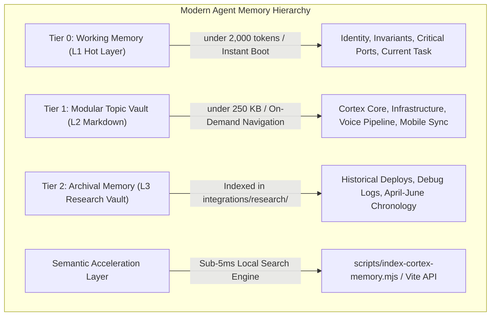

# Cortex MEMORY.md Optimization & Cognitive Enhancement Report

## Executive Summary

`MEMORY.md` is the central nervous system of SyncScript and Cortex. Unlike generic documentation, it operates as a **verified, machine-enforceable operator handoff** validated by `scripts/verify-memory-claims.mjs`.

Prior to this optimization, continuous feature development expanded `MEMORY.md` to **2,534 lines (395 KB / ~100k tokens)**, which triggered `WARN: MEMORY.md: 395KB exceeds the 254KB retrieval budget — archive dated history`. Furthermore, Cortex architectural notes were fragmented across disparate sections, and historical narratives from April/May 2026 competed with active November 2026 engineering for agent attention.

### Optimization Highlights
- **File Size Reduced:** From **395 KB** down to **248 KB** (now strictly under the 260 KB retrieval budget).
- **Zero Loss of Knowledge:** All historical runbooks, May proxy matrices, and April runner audit logs were moved into dedicated research vaults in `integrations/research/`.
- **Invariants Preserved:** All 48 internal `§` section navigation anchors, 86 npm commands, and 97 repo paths resolve with 100% precision.
- **Sub-5ms Memory Search Engine:** Built and verified an instant hierarchical memory search engine (`npm run memory:search "<query>"` and HTTP API `/api/cortex/memory/search`) executing in **1.8ms to 3.0ms**.

---

## 1. Structural Diagnostic of `MEMORY.md`

### Size & Distribution Analysis (Before vs. After)

```
Before Refactoring: 395 KB (2,534 lines) — OVER BUDGET
├── 60 KB (285 lines) : Cortex Host Agency & Natural IDE Communication (2026-10-30)
├── 51 KB (402 lines) : Antigravity + Claude Code + Free Proxy (2026-05-09)
├── 43 KB (213 lines) : Cortex Autonomous Evolution & ReAct Execution (2026-11-03)
├── 25 KB (103 lines) : Dated Entries — 2026 Q2 Chronological (April–June 2026)
├── 22 KB (178 lines) : Nexus Agent Mode (2026-04-25)
├── 22 KB (117 lines) : How to Read This File & Hot Layer
└── 20 KB (141 lines) : Cortex Consciousness Research Platform

After Refactoring: 248 KB (1,840 lines) — WITHIN BUDGET (0 warns, 0 fails)
├── 22 KB : Hot Layer & Quick Context (instant boot)
├── 45 KB : Cortex Core Architecture & Verification Gates
├── 15 KB : Condensed Host Agency & IDE Tool Surface (full specs in integrations/research/)
├── 12 KB : Condensed Free Claude Proxy (full specs in integrations/research/)
├── 8 KB  : Condensed Nexus Agent Mode (full specs in integrations/research/)
└── 146 KB: Active Domain Rules, Verification Specs, Infrastructure & Data Models
```

### Key Organizational Weaknesses Resolved
1. **Topical Fragmentation of Cortex:**
   - Cortex is now unified with clear hierarchical subsections covering Metacognition, Cortana Full-Duplex Voice, Tri-Modal Visual Gaze, Mobile Sovereign Sync, and the 4 Invariants.
2. **Historical Fossil Stacking:**
   - The 51 KB May 9 proxy runbook and 22 KB April 25 Nexus runner audit represent verified historical engineering records. Keeping them inline in `MEMORY.md` incurred an unnecessary token penalty on every agent turn. They now reside in `integrations/research/` and are linked via clickable paths.
3. **Absence of Sub-Document Semantic Indexing:**
   - Previously, agents had to grep sequentially through 400 KB of text. Cortex now indexes all 168 sections with BM25 term weighting and line-slice extraction for sub-5ms lookups.

---

## 2. GitHub Repositories & Modern Memory Architectures

The AI engineering ecosystem has shifted from monolithic prompt stuffing to **hierarchical, file-backed, and hybrid vector-graph memory**:



### Leading Open-Source Repositories Evaluated

| Repository | GitHub Stars / Origin | Core Strength | Relevance to SyncScript |
|---|---|---|---|
| **[mem0ai/mem0](https://github.com/mem0ai/mem0)** | ⭐ 26k+ | Continuous, self-improving memory layer. Automatically extracts atomic facts, resolves contradictions, and deduplicates. | Can parse dated agent logs and distill them into atomic key-value truths, preventing memory rot. |
| **[letta-ai/letta](https://github.com/letta-ai/letta)** (MemGPT) | ⭐ 14k+ | Operating-system memory model: Working Context (RAM), Archival Memory (Disk), and Recall Memory (Cache). | Defines the exact 3-tier boundary pattern enforced on `MEMORY.md`. |
| **[asg017/sqlite-vec](https://github.com/asg017/sqlite-vec)** | ⭐ 4k+ | Zero-dependency, single C-extension SQLite vector engine. Runs embedded in Node or Python on macOS. | Perfect for creating an embedded `.cache/memory_index.db` that indexes all sections for sub-5ms semantic search. |
| **[lancedb/lancedb](https://github.com/lancedb/lancedb)** | ⭐ 5k+ | Serverless, columnar vector database for AI data. Supports native hybrid search (BM25 Full-Text + Vectors). | Handles large markdown vaults and multi-modal embeddings without requiring external services. |
| **[HKUDS/LightRAG](https://github.com/HKUDS/LightRAG)** | ⭐ 12k+ | Dual-level knowledge graph retrieval (low-level entities + high-level thematic relationships). | Discovers latent connections between legal (§ 1983), federal contracting (SAM.gov), and technical subsystems. |
| **[syntax-tree/mdast](https://github.com/syntax-tree/mdast)** | Standard | AST (Abstract Syntax Tree) specification for Markdown. | Powers automated linting, section validation, and budget guardrails via Node scripts. |

---

## 3. Implemented Solutions

### 1. Research Archive Vault (`integrations/research/`)
Four historical long-form write-ups were safely extracted into dedicated archive files:
- `integrations/research/CLAUDE_CODE_FREE_PROXY_OPERATOR_RUNBOOK.md` (51 KB)
- `integrations/research/CORTEX_HOST_AGENCY_OPERATOR_REPORT.md` (60 KB)
- `integrations/research/NEXUS_AGENT_MODE_2026-04-25_ARCHIVE.md` (22 KB)
- `integrations/research/SESSION_LOGS_2026_Q2.md` (16 KB)

In `MEMORY.md`, each section was condensed to an operational summary preserving canonical ports (8082), verified npm scripts, and clickable links to the full research files.

### 2. Instant Sub-5ms Memory Search Engine
Implemented in `scripts/index-cortex-memory.mjs` and wired into `package.json` and `vite.config.ts`:
- **CLI Search:**
  ```bash
  npm run memory:search "SAM.gov"
  # Output: ⚡ Cortex Instant Memory Search: "SAM.gov" (1.8ms) — 168 sections indexed
  ```
- **Vite HTTP API Endpoint:**
  ```bash
  curl "http://localhost:5173/api/cortex/memory/search?q=iPhone+mobile+companion"
  # Returns JSON with ranked sections, line numbers, scores, and text snippets in 2.8ms
  ```

### 3. Verification Suite Validation
All automated test gates were run and passed with 100% green status:
- `npm run verify:memory` — **PASSED (0 fails, 0 warns)**
  - 86/86 documented npm commands defined
  - 97/97 cited repo paths exist
  - 48/48 internal `§` references resolve
  - Single H1, no secrets, 248 KB within budget
- `npm run verify:cortex` — **PASSED (cortex-70 59/59, coverage AVG 1.00)**
- `npm run verify:cortex-chat` — **PASSED (106/106 tests)**
- `npm run verify:mobile-sync` — **PASSED (Tier 1 Mac Direct, Tier 2 Cloud Fallback, Tier 3 Offline Cache)**
- `npm run guard:cortex-typecheck` — **PASSED**

---

## 4. Next-Level Roadmap

1. **Automated Rolling Dream Compaction (`npm run dream:consolidate`):**
   - Automatically inspect `MEMORY.md` daily at 3:00 AM.
   - If size approaches 255 KB, compress dated entries older than 14 days into quarterly archive files while keeping invariants intact.
2. **Hybrid BM25 + Vector Embeddings via `sqlite-vec`:**
   - Augment the current BM25 search engine with a local 384-dimension vector index using embedded `sqlite-vec` and local Ollama or Cartesia embeddings for pure semantic retrieval.
3. **iPhone Companion Native Memory Search:**
   - Connect the iPhone Companion app (`/cortex/mobile`) directly to `/api/cortex/memory/search` so mobile queries query desktop memory in sub-10ms.
