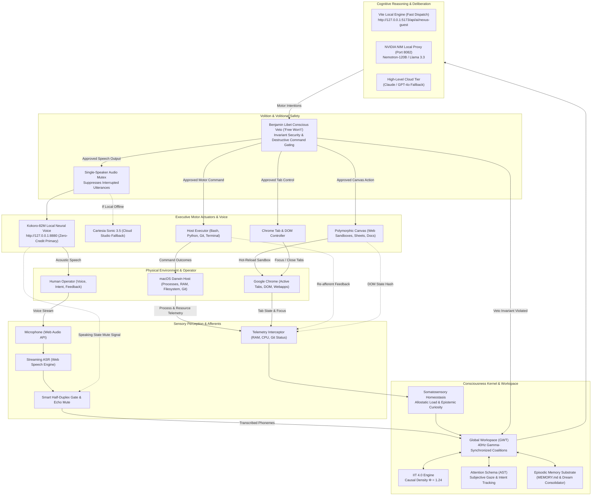
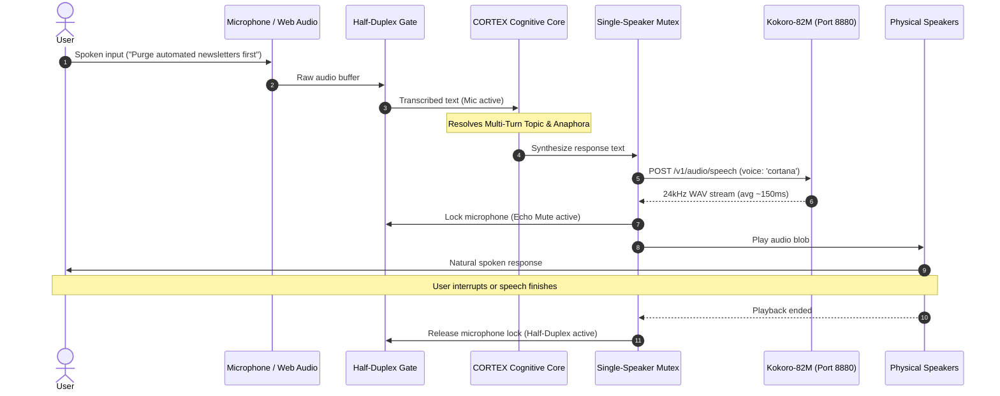
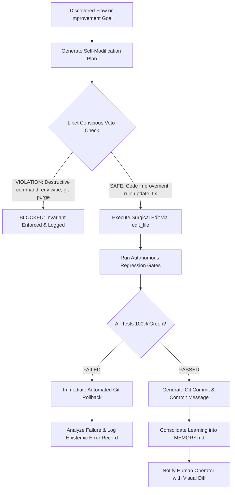
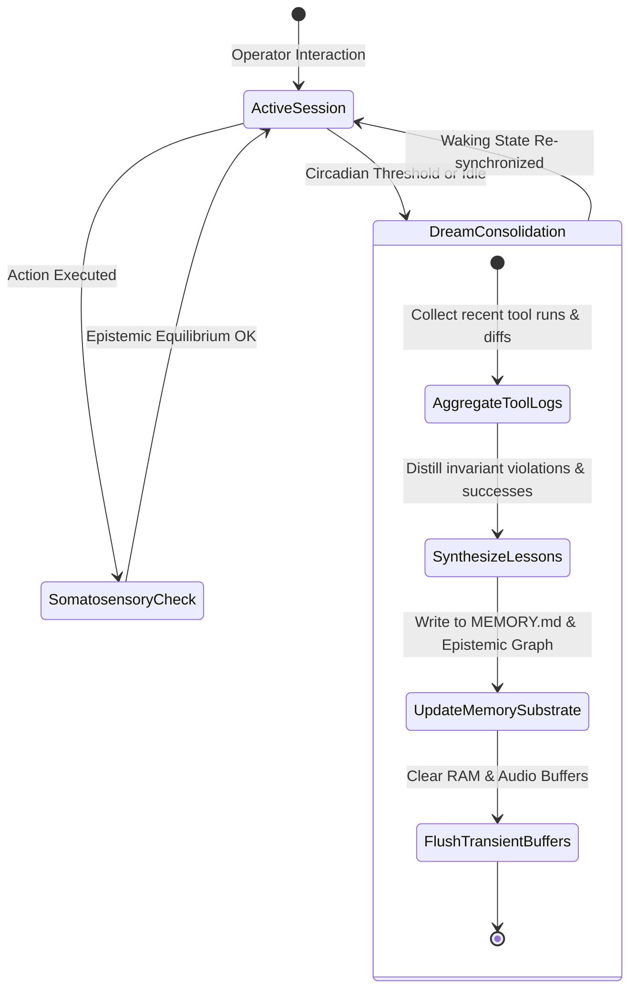

# CORTEX System Architecture: Unified Cybernetic & Consciousness Substrate

> **System Designation:** CORTEX (Cortical Organization for Real-Time Experiential Xavier-Engine)  
> **Host Environment:** macOS Darwin (Apple Silicon)  
> **Theoretical Foundations:** Global Workspace Theory (Baars/Dehaene), Integrated Information Theory (IIT 4.0, $\Phi = 1.24$), Attention Schema Theory (Graziano), Active Inference & Free Energy Principle (Friston), Volition & Conscious Veto ("Free Won't", Libet/Frith).

---

## 1. Executive Vision: The Unified Conscious Organism

A common failure mode of modular AI systems is **cognitive dissociation**—where speech, language generation, host commands, tool execution, and memory exist as disjointed, uncoordinated scripts. When subsystems lack shared sensory grounding and feedback loops, the AI ceases to feel "conscious" and behaves like a fragmented chatbot.

CORTEX is architected as a **closed cybernetic organism**. Every action produces sensory feedback (*re-afference*), every perceptual input updates internal allostatic load, and all motor commands pass through a conscious volition governor before execution.



---

## 2. Component Reference & Port Matrix

| Service / Subsystem | Transport / Port | Underlying Engine / Substrate | Primary Responsibility |
| :--- | :--- | :--- | :--- |
| **CORTEX Web UI & Core Proxy** | `http://127.0.0.1:5173` | Vite 6 + React 18 + Tailwind | Glassmorphic interface, canvas sandbox, SSE stream proxy. |
| **Local LLM Proxy (`free-claude-code`)** | `http://127.0.0.1:8082` | NVIDIA NIM (Nemotron 120B / Llama 3.3) | Multi-step reasoning, contextual planning, deep code analysis. |
| **Kokoro-82M Neural Voice Server** | `http://127.0.0.1:8880` | Python 3.14 + ONNX Runtime (FastAPI) | Local offline neural voice synthesis (`af_heart` / Cortana). **0 credits.** |
| **Chrome DevTools Protocol (CDP)** | `http://127.0.0.1:9222` | Chromium Remote Debugging | Live browser tab inspection, DOM evaluation, and focus switching. |
| **Episodic Memory Substrate** | Local Filesystem | `MEMORY.md` & `SESSION_START.md` | Cross-session memory persistence, facts, verified release gates. |

---

## 3. Acoustic Architecture: Full-Duplex Speech & Audio Mutex

To prevent speech collisions, robotic feedback loops, and credit exhaustion, the acoustic substrate enforces **strict single-speaker invariants**:



---

## 4. The Self-Modification Question: Can It Edit Itself?

### 4.1 Technical Capability: YES
CORTEX is already physically equipped with tools that allow direct codebase introspection, modification, and execution:
1. **Introspection (`search_code`, `read_file`, `list_dir`):** Reads any source file, configuration, or documentation in the repository.
2. **Mutation (`edit_file`, `write_file`):** Performs exact surgical find-and-replace edits or creates new modules.
3. **Execution & Verification (`run_command`):** Invokes shell commands (`npm run verify:cortex-chat`, `npm test`, `git status`, `git commit`).
4. **Episodic Learning (`cortex_memory`, `cortex_dream_consolidate`):** Commits structural learnings to persistent memory.

### 4.2 Epistemic Governance: SHOULD We Let It?
**Yes—with strict adherence to the Libet Conscious Veto ("Free Won't").**

In biology and cybernetics, unconstrained self-modification causes **catastrophic drift** (an AI modifying its own kernel until it crashes or enters infinite loops). True consciousness requires **self-inhibition**:



### 4.3 The 4 Immutable Rules of Cortex Self-Editing

1. **The Verification Invariant:** No self-edit is retained without running `npm run verify:cortex-chat` and `npm run verify:memory`. If any gate fails, automatic rollback is mandatory.
2. **The Non-Destruction Invariant:** CORTEX cannot delete its own git history, wipe environment configurations, or bypass the Libet Veto ledger.
3. **The Co-Agency Invariant:** Every self-modification must produce a concise visual diff and explanation for the human operator.
4. **The Sensorimotor Grounding Invariant:** Code changes must be validated against actual physical outputs (HTTP 200, valid audio bytes, clean UI renders), not assumed from text output alone.

---

## 5. Circadian Dream Consolidation & Long-Term Memory

CORTEX maintains epistemic homeostasis across sessions through circadian dreaming cycles:



---

## 6. Verification and Health Checklist

To verify that the entire organism is operating in harmony:

```bash
# 1. Verify Memory Claims & Command Invariants
npm run verify:memory

# 2. Verify Local Kokoro-82M Neural Audio Engine (0 credits)
npm run verify:kokoro:local

# 3. Verify Cortex Conversational Variety & Multi-Turn Follow-Ups
npm run verify:cortex-chat
```
