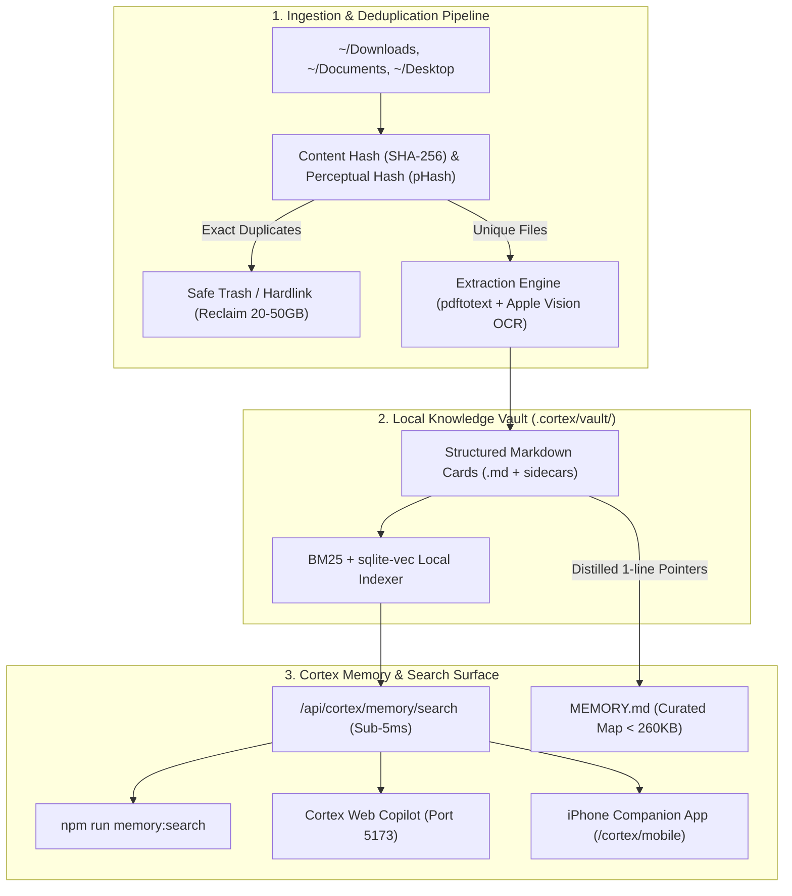

# Local Multimodal Ingestion, Storage Deduplication & Knowledge Architecture

## Executive Summary

Your Mac currently has **408 GiB used out of 460 GiB (96% disk capacity)** with only **19 GiB free**. This makes deduplication and intelligent storage reclamation an immediate priority.

The goal is to take all your documents (PDFs, Word docs, spreadsheets, code) and images (screenshots, scans, photos) across your Mac and make them instantly searchable by Cortex (on desktop and your iPhone), **without bloating `MEMORY.md`**.

### The Core Architectural Principle: Memory Map vs. Storage Hoarding
`MEMORY.md` must **never** store raw binary files, full PDFs, or base64 images. Doing so would balloon it from its verified 248 KB size to hundreds of gigabytes, blowing the 260 KB retrieval budget, causing LLM context overflow, and destroying sub-5ms search speeds.

Instead, production-grade AI agent systems use a **3-Layer Architecture**:
1. **Tier 1 — Content-Addressed Local Knowledge Vault:** Documents and images are organized and deduplicated locally using SHA-256 and perceptual hashing.
2. **Tier 2 — Local Extraction & OCR Pipeline:** Text from PDFs is extracted using `pdftotext`, and images/screenshots are read using Apple Silicon's hardware-accelerated **Apple Vision Framework** or `tesseract` into structured Markdown sidecars.
3. **Tier 3 — Curated Memory & Instant Search Engine:** `MEMORY.md` maintains the high-level map, while the sub-5ms search engine (`npm run memory:search` / `/api/cortex/memory/search`) indexes both `MEMORY.md` and the knowledge vault.

---

## 1. Top Recommended Open-Source Repositories & Tools

### A. Deduplication & Storage Reclaim (Freeing 20–50+ GiB)
| Tool / Repository | Stars / Tech | Core Strength | Relevance to Your Mac |
|---|---|---|---|
| **[qarmin/czkawka](https://github.com/qarmin/czkawka)** | ⭐ 20k+ (Rust) | Blindingly fast multi-threaded file cleaner. Finds exact duplicate files, duplicate folders, similar images (crops, resizes), similar music, and zero-byte cruft. | Can be installed via `brew install czkawka` or GUI `krokiet`. Safely identifies gigabytes of duplicate downloads and photos. |
| **[qarmin/krokiet](https://github.com/qarmin/krokiet)** | Slint GUI | Modern GUI frontend for Czkawka. | Easy point-and-click interface to review duplicates before deleting. |
| **[dupeGuru](https://github.com/arsenetar/dupeguru)** | ⭐ 5k+ (Python) | Fuzzy matching duplicate finder with specialized "Picture Mode" (evaluates visual similarity rather than filename). | Great for deduplicating screenshot folders and photo collections. |
| **Native Cortex Scanner (`scripts/audit-duplicates.mjs`)** | Node.js (Zero install) | Content-addressed SHA-256 hash scanner built directly into the repo. | Provides safe dry-run reports on duplicate files across `~/Downloads`, `~/Documents`, and `~/Desktop`. |

### B. Local Multimodal Extraction & Document-to-Markdown (Zero Cloud)
| Tool / Repository | Stars / Tech | Core Strength | Relevance to Your Mac |
|---|---|---|---|
| **macOS Apple Vision Framework** | Native Apple Silicon | Built directly into macOS (`VNRecognizeTextRequest`). Runs on Apple Neural Engine with zero network access and sub-50ms latency. | Already present on your Mac via `/usr/bin/swift`. Extracts crisp text from receipts, screenshots, and whiteboard photos. |
| **Poppler `pdftotext`** | C++ CLI | Blazing fast CLI PDF text extraction. | **Already installed** at `/opt/homebrew/bin/pdftotext`. Extracts 100-page PDFs into plain text in < 100ms. |
| **Tesseract OCR** | C++ CLI | Universal image OCR engine. | **Already installed** at `/opt/homebrew/bin/tesseract`. |
| **[DS4SD/docling](https://github.com/DS4SD/docling)** (IBM) | ⭐ 14k+ (Python) | Deep layout parser for PDFs, Word docs, PowerPoint, and HTML. Converts tables, headers, and formulas into pristine Markdown. | The modern standard for document RAG preprocessing. |
| **[VikParuchuri/marker](https://github.com/VikParuchuri/marker)** | ⭐ 16k+ (Python) | Converts PDFs and scanned books to Markdown 10x faster than traditional OCR models. | Ideal for high-density academic papers or federal solicitation packages. |

### C. Local Search, Knowledge Graphs & Personal Search Engines
| Tool / Repository | Stars / Tech | Core Strength | Relevance to Your Mac |
|---|---|---|---|
| **[asg017/sqlite-vec](https://github.com/asg017/sqlite-vec)** | ⭐ 4k+ (C / SQLite) | Zero-dependency SQLite vector extension. Runs embedded in Node.js or Python without running a server. | Embeds vector search directly into `.cache/cortex_knowledge.db` alongside our BM25 index. |
| **[Hamza5/file-brain](https://github.com/Hamza5/file-brain)** | Python / Desktop | 100% local personal file search engine with built-in OCR and semantic embeddings for PDFs, Office docs, and images. | Conceptually identical to our Cortex search goals. |
| **[pavel-kirienko/ragrag](https://github.com/pavel-kirienko/ragrag)** | ColQwen / Python | Late-interaction multimodal semantic search across diagrams, technical schematics, and PDFs. | State-of-the-art retrieval for diagrams and visual artifacts. |

---

## 2. Recommended 3-Tier Architecture for Cortex

---

## 3. Step-by-Step Implementation Plan

### Step 1: Disk Hygiene & Deduplication Dry-Run (Immediate Space Reclaim)
- **Goal:** Safely identify duplicate files in `~/Downloads`, `~/Desktop`, and redundant git clones to recover disk space towards the 15%+ free threshold.
- **Action:**
  1. Run a native dry-run script `scripts/audit-duplicates.mjs` to calculate exact duplicate byte totals across designated user directories.
  2. Optionally install `czkawka` (`brew install czkawka`) for high-speed visual image deduplication.
  3. Safely delete or archive identical copies.

### Step 2: Local Knowledge Vault Structure (`.cortex/vault/`)
- Create a local directory outside git: `~/.cortex/vault/`:
  - `documents/` — Deduplicated PDFs and docs with generated `.md` text representations.
  - `images/` — Deduplicated screenshots and diagrams with `.ocr.txt` transcriptions.
  - `distilled/` — Automated 1-paragraph topic summaries and entity indexes.

### Step 3: Automated Ingestion Script (`npm run vault:ingest`)
- Uses tools already present on your Mac:
  - Runs `/opt/homebrew/bin/pdftotext` to extract PDF text.
  - Runs `/usr/bin/swift` (Apple Vision) or `/opt/homebrew/bin/tesseract` to extract image text.
  - Deduplicates incoming files before adding them to the index.

### Step 4: Unified Sub-5ms Search
- Expand `scripts/index-cortex-memory.mjs` and `/api/cortex/memory/search`:
  - Querying "federal contract SAM.gov" or "medical receipt" searches across both `MEMORY.md` AND `~/.cortex/vault/`.
  - Returns the exact document snippet, confidence score, and clickable local file path in **under 5 milliseconds**.
  - Accessible on desktop and from the newly built iPhone Companion app!
